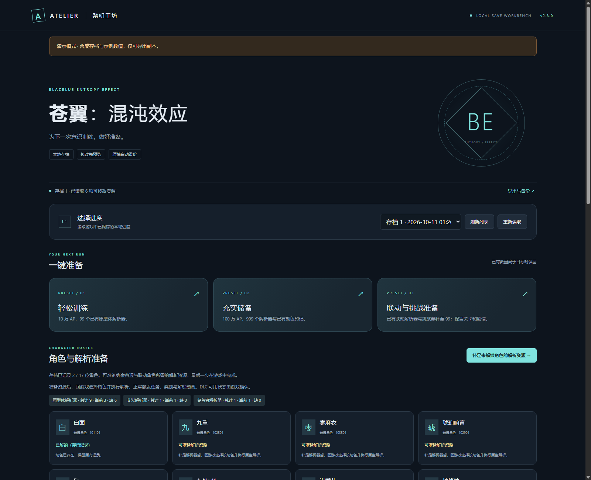

# 苍翼：混沌效应

黎明工坊提供独立的《苍翼：混沌效应》（BlazBlue Entropy Effect）本地存档工作台。已核对 Steam 构建 **25627491**；目前开放已确认资源的数量调整。



## 打开工作台

Windows 桌面版打开启动设置，点击 **打开苍翼工作台**。无需安装或准备《黎明门前的吹笛人》的资料。

源码版运行：

```powershell
python game_workbench.py --game blazblue --open
```

只想体验界面，可使用合成数据：

```powershell
python game_workbench.py --game blazblue --demo --port 18769 --open
```

工作台会查找 Steam 用户目录中的数字存档槽。刚在游戏里新建或保存的进度，可点击 **刷新列表**、**重新读取**；打开下拉框或切回工作台也会刷新列表。旧草稿按存档指纹保留，不会自动套用到新进度。

## 可以修改什么

| 资源 | 支持方式 |
| --- | --- |
| AP | 调整已有数量，回游戏正常消费 |
| 原型体解析器 | 补足已有数量，回游戏选择并解析原型体 |
| 颜色印记 | 调整已有数量，回游戏兑换可用配色 |
| 艾希解析器、枭首者解析器 | 调整已有记录，保留联动关卡、剧情和领取状态 |
| 第 1–4 轮挑战券 | 调整已有记录，保留轮次、挑战和领奖状态 |

当前开放以上 **9 种资源**，只显示所选存档中已存在的记录。数量为 0 的已有记录仍可调整；没有记录的资源不会新增。单项支持 0–99,999,999 的整数。

三套预设：

- **轻松训练**：AP 补至 100,000，原型体解析器补至 99。
- **充实储备**：AP 补至 1,000,000，原型体解析器和已有颜色印记补至 999。
- **联动与挑战准备**：已有联动解析器及挑战券补至 99。

预设保留已有更高数值，缺少对应记录时会明确跳过。可以先加入清单，再改目标数量或移除单项。

## 保存与恢复

点击 **预览并保存**，检查原值和目标值。导出与直接应用都会先备份原档。

- **导出副本**：原存档不变。下载后的文件名使用原槽位名，例如 `1`。退出游戏后，替换对应位置的同名文件，再进入游戏读取。
- **备份并直接应用**：只在确认游戏已退出时开放，替换本次选中的主存档。
- **恢复**：打开 **导出与备份**，下载修改前的原档。退出游戏后放回同名槽位。

默认 Steam 存档位置：

```text
%USERPROFILE%\AppData\LocalLow\91Act\BlazBlueEntropyEffect\Steam\<账户目录>\Save\<槽位号>
```

工坊备份和导出分别位于用户数据目录的 `data/games/blazblue/backups/blazblue/` 与 `data/games/blazblue/modified-saves/`。游戏自己的两个 Backup 目录、PlayerData、CloudData 不会被修改。

## 当前范围

角色属性、训练中的血量和伤害、潜能、策略、剧情与直接解锁尚未开放。解析器补给后仍需在游戏中操作；资源数量变化不会补记获得或消耗资源的历史任务，也不会回放解锁奖励。

已完成真实存档副本往返、未知内容保留、独立 LZ4 解码器复核，以及合成数据的预览、导出和备份验证。**尚未完成游戏内读取修改副本的验证**，首次使用请保留原档。

兼容判定核对与存档和道具相关的配置、编码与游戏逻辑资源，不以 Steam 构建日期作为唯一门槛。相关规则发生变化时会要求更新适配器。

## 手动指定位置

源码版可设置 `BLAZBLUE_GAME_DIR` 和 `BLAZBLUE_SAVE_DIR`。前者指向包含 `BlazblueEntropyEffect.exe` 的目录，后者指向包含数字槽位文件的 `Save` 目录。

桌面版可在本地 `config.local.json` 中设置 `blazblue_game_dir` 和 `blazblue_save_dir`，然后重新打开工作台。配置只保存在本机。

实现依据见 [苍翼适配记录](blazblue-implementation.md)。
